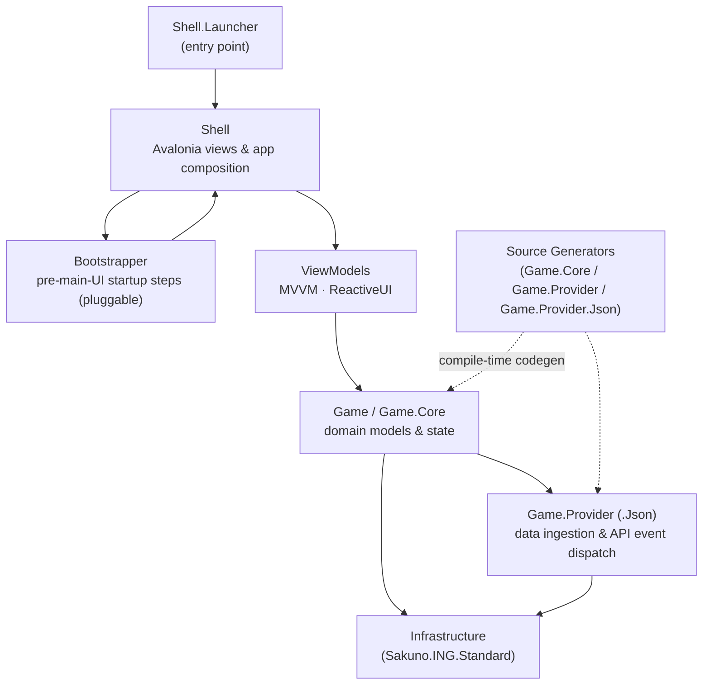

# ING

[](https://github.com/amatukaze/ing/actions/workflows/build-and-test.yml)

A flexible, powerful and lightweight KanColle tool/browser.

## Screenshots (Legacy Version)


## Branches

| Branch | Description |
|---|---|
| `master` | Generation 2 (in progress): full rewrite with Avalonia + ReactiveUI |
| `legacy` | Generation 1: WPF, released version |

## Architecture



Startup runs through a bootstrapper: a bootstrap window executes pluggable `IBootstrapStep`s (progress shown, failures offer retry/skip/exit) before the main window and the game browser window are created.

## Build & Run

Requires the **.NET 11 SDK**.

```bash
git clone https://github.com/amatukaze/ing.git
cd ing

dotnet build

# Run the desktop client
dotnet run --project src/Shell/Sakuno.ING.Shell.Launcher

# Run all tests
dotnet test
```

### Local UI Component Automation

The opt-in MCP server hosts isolated Avalonia UI Component Scenarios without starting the desktop App, bootstrap, game browser, or real player services. It requires the .NET 11 SDK and Bash on the local development machine.

For Kimi Code, the project-level `.kimi-code/mcp.json` starts the server automatically in a new trusted session. Review and trust the workspace when prompted, then use `/mcp` to confirm the `ing-ui-component-automation` connection. Headless Kimi sessions also require `KIMI_CODE_TRUST_WORKSPACE=1` for project-level MCP configuration.

Other stdio MCP clients can launch the same protocol-safe wrapper:

```bash
./src/Shell/Sakuno.ING.Shell.UIComponentAutomation/run-mcp.sh
```

The wrapper writes build output and diagnostics to stderr, then execs the built server so stdout contains only MCP messages. Do not launch the server through `dotnet run` on protocol stdout.

Available scenarios:

| Identifier | UI Component | Deterministic state |
|---|---|---|
| `Overall/FleetTab/WithFleets` | `FleetTab` | Three fleets; fleet 1 initially selected and fleet 2 displayed as an unselected tab |
| `Overall/Materials/WithData` | `Materials` | Representative values for all eight materials, resolved through the View's normal DI initialization |

Available tools:

- `list_scenarios` — list stable scenario identifiers and UI Component metadata.
- `open_scenario` — construct and lay out a candidate before replacing the active scenario.
- `inspect_component` — return bounded visual-tree information and the read-only scenario state snapshot; optional `rootIdentifier`, `maxDepth`, and `maxNodes` parameters.
- `click` — click a unique visible, enabled AutomationId or Name using real headless input.
- `input_text` — type into a unique visible, enabled TextBox using real headless input.
- `capture_screenshot` — return PNG image content plus scenario ID and dimensions.
- `reset_scenario` — construct a fresh initial instance of the active scenario.
- `close_scenario` — dispose the active scenario and its owned resources.

The transport integration test exercises the real built server and MCP client over stdio, including FleetTab selection and reset, Materials values, PNG captures, protocol-clean stdout, and EOF shutdown:

```bash
DiffEngine_Disabled=true dotnet test \
  --project src/Shell/Sakuno.ING.Shell.UIComponentAutomation.Tests/Sakuno.ING.Shell.UIComponentAutomation.Tests.csproj \
  --filter-class Sakuno.ING.Shell.UIComponentAutomation.Tests.McpTransportTests
```

### License
The MIT License (MIT)
